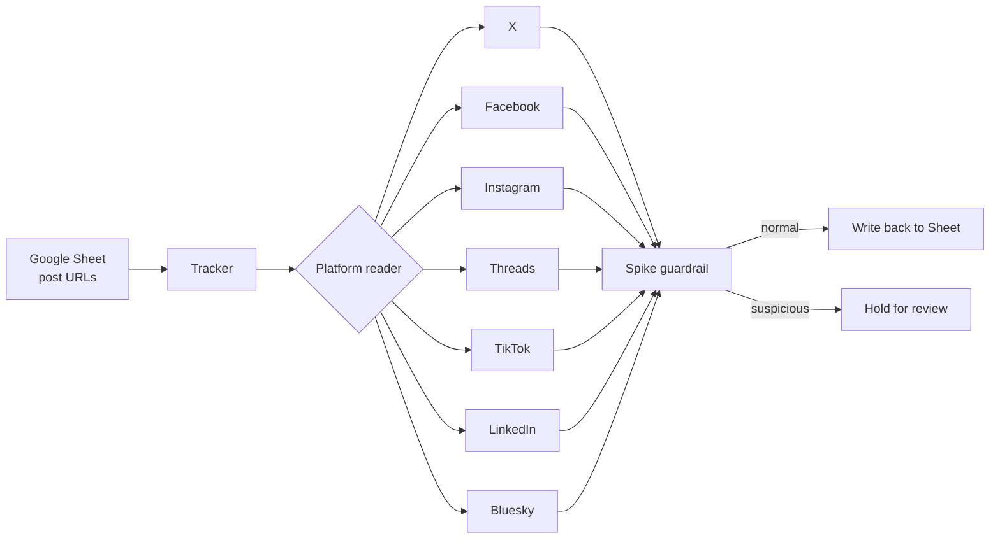

### Hi, I'm Ikram 👋

I build small, practical automations that take repetitive manual work off
people's desks. Most of what I write starts the same way: I notice a task
my team does by hand every day, then script it end to end.

**Day to day** I work in media monitoring (tracking news and social coverage
for a corporate client) and in student visa operations at a language centre.
Both jobs are full of copy-paste work, which is where my projects come from.

#### What I've built

- **[EMGS Visa Tracker](https://github.com/ahmdikrm/emgs-visa-tracker)**:
  checks international students' visa applications on Malaysia's EMGS portal
  and keeps the team's Google Sheet up to date. Later moved to Google Apps
  Script so it runs on a schedule in the cloud and emails at key milestones.
- **Social Engagement Tracker** *(private, client work)*: see the case study below.
- **Reporting helpers** *(private)*: scripts that sync monitoring keywords
  and refresh daily data sheets for reports.

---

#### Case study: Social Engagement Tracker

**The problem.** Our monitoring team reports how much engagement (likes,
comments, shares) a client's coverage gets on social media. Collecting those
numbers meant opening every post by hand, across seven platforms, and typing
the figures into a spreadsheet. The list grew to tens of thousands of posts.

**What I built.** A Python + Selenium tool that reads the post list from a
Google Sheet, visits each post, reads its engagement figures, and writes them
back, every day, without anyone retyping numbers.

**Scale.** 24,000+ post URLs across 7 platforms, refreshed daily, with a
morning report comparing overnight changes.

**Hard problems I solved**

- **Sites change without warning.** When X rebuilt its front end, the old way
  of reading numbers stopped working overnight. I rewrote the reader to try
  two strategies (the old page markers and the new accessibility labels) so
  it keeps working through either version.
- **Reading the right number.** On Facebook, pop-up dialogs contain several
  reaction counts, and the tool sometimes picked up the wrong one. I scoped
  the reader to the correct container and flagged ambiguous cases instead of
  guessing.
- **Matching the right post.** On Threads, replies can look like the main
  post. I matched each post to its author's handle so comments are never
  credited to the wrong post.
- **Trusting the output.** An early version once produced a wrong figure. I
  added a guardrail: drops are ignored, but sudden spikes (e.g. a 5x jump
  overnight) are held back for a human check before anything is reported.
  The aim is that a wrong number never reaches a report silently.

**What I'd do differently.** It grew as one large script over many versions.
If I rebuilt it today, I'd split each platform reader into its own module
with tests, so a change on one site can't break the others.

*Code is private because it's client work. Happy to walk through how it works
in an interview.*

---

#### Tools I use

`Python` · `Selenium` · `Google Sheets API / gspread` · `Google Apps Script` ·
`Excel` · `Git` · `Talkwalker` · `Boolean search`

📍 Kuala Lumpur, Malaysia
